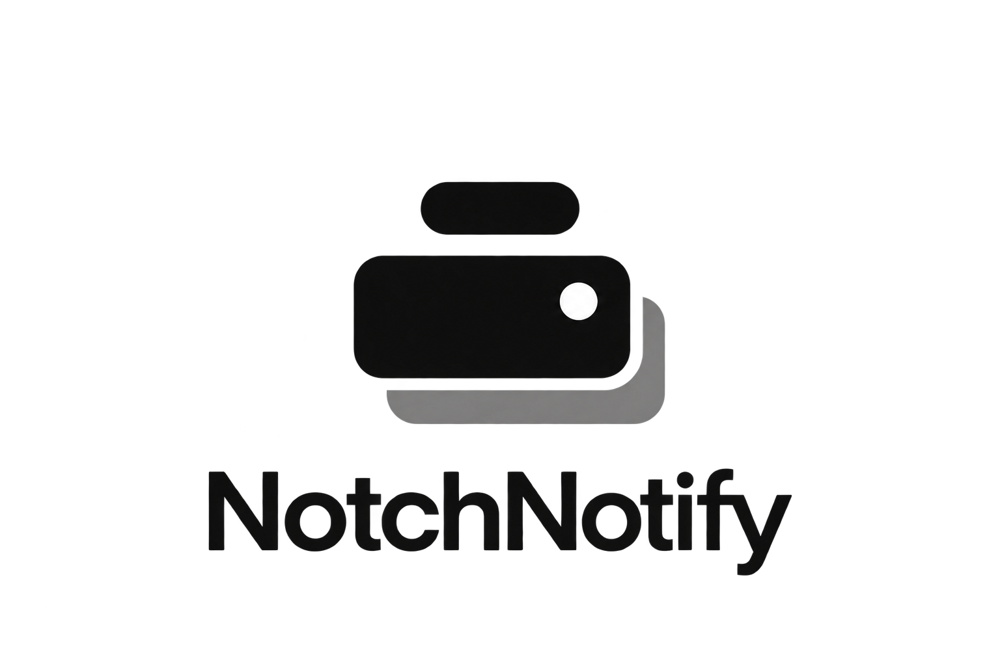

# NotchNotify



A macOS menu-bar app that brings your notifications to the notch.

NotchNotify watches for notification banners and shows them as a black card that
grows out of the camera notch, instead of in the top-right corner. On displays
without a notch, the card grows from a small pill at the top center.

## Features

- **Notch cards.** Choose Expand (default), Drop down, Ease in/out, Fade, or Bounce.
  Click a card to open the app; the close button hides it. Notification Center
  keeps the notification either way.
- **Native mode.** Keep the real macOS banner, including reply and action buttons,
  but move it to the top center.
- **Stacking.** Up to three cards at once, with extras queued until there is room.
  Smaller displays show fewer. Turn stacking off to show one at a time.
- **Show for** 3, 5 (default), 8, 10, 15 or 30 seconds, or until dismissed. Hover
  over the notch or any card to pause the whole stack.
- **Show on** the main display (default), the built-in display, or the display with
  the pointer. The built-in option falls back to the main display when the lid is closed.
- **Motion.** *Follow macOS* respects Reduce Motion with a short fade. *Full
  animations* always uses the selected style.
- **Preview** the look without granting any permission, and turn on **Open at Login**
  from the menu bar.

## Install

Requires macOS 14 Sonoma or later, on Apple silicon or Intel.

1. Download `NotchNotify-<version>.zip` from the
   [latest release](https://github.com/jakobkollerup/NotchNotify/releases/latest)
   and move **NotchNotify.app** to **Applications**.
2. Open it. NotchNotify is not yet notarized by Apple, so macOS blocks the first
   launch. Open **System Settings › Privacy & Security**, scroll down, and click
   **Open Anyway** next to NotchNotify. You only need to do this once per download.
3. In NotchNotify's settings, click **Grant access** and turn on **NotchNotify** under
   **System Settings › Privacy & Security › Accessibility**.
4. Click **Send test notification** and allow NotchNotify's own notifications when asked.

Keep notifications enabled for the apps you want to see in the notch. Quit any other
notification-positioning utility, since two apps moving the same banner fight each other.

Because the app is not signed with a Developer ID, macOS may ask you to grant
Accessibility again after you install an update. If NotchNotify stops reacting,
remove it from the Accessibility list with **–** and add it again.

Each release lists a SHA-256 checksum. To verify a download:

```sh
shasum -a 256 NotchNotify-<version>.zip
```

## Privacy

NotchNotify runs entirely on your Mac. It has no network code, no analytics and no
update checks. To draw a card, it reads the app name, title and body of each banner
through the Accessibility API and keeps them in memory only, for as long as it
needs them to show and update cards. It never writes notification text to disk or to the system log;
its in-memory activity log records app names and timings only. It needs
Accessibility permission because macOS offers no other way for one app to see
another app's banners.

## Known limitations

- **The original banner can still appear briefly.** macOS only tells other apps about
  a banner after it has started to show it, so on a new notification the corner
  banner can be visible for a frame or two before NotchNotify hides it.
- **Actions and replies** are only available in Native mode. Clicking a notch card
  opens the app. Once the original banner has expired, the notification's specific
  deep link may no longer be available.
- **macOS updates can break it.** Notification Center is not a public integration API,
  and its Accessibility structure changes between releases.
- Cards and the waiting queue live only in memory. They are cleared when you pause,
  quit, or switch to Native mode.
- Rapid, identical notifications that macOS merges into one banner show as one card.

## Uninstall

Quit NotchNotify from the menu bar (this puts any moved banners back), turn off
**Open at Login** if you enabled it, and drag the app to the Trash. Optionally remove
it from **Privacy & Security › Accessibility** and delete its preferences:

```sh
defaults delete io.github.jakobkollerup.notchnotify
```

## Build from source

You need the Swift toolchain from Xcode or the Command Line Tools, matching your
installed macOS SDK.

```sh
bash scripts/build-notch.sh                          # this Mac's architecture
ARCHS="arm64 x86_64" bash scripts/build-notch.sh     # universal, as released
open build/NotchNotify.app
```

Builds are ad-hoc signed unless `NOTCH_SIGN_IDENTITY` names a codesigning identity.
With an ad-hoc build, macOS may ask you to remove and re-add the Accessibility entry
after every rebuild. Building never installs, launches, or registers a login item.

## Development

```sh
bash scripts/test.sh --skip AXIntegrationTests
python3 scripts/check-branding.py --app build/NotchNotify.app
build/NotchNotify.app/Contents/MacOS/NotchNotify --render-preview build/previews
build/NotchNotify.app/Contents/MacOS/NotchNotify --smoke-test
```

- `--render-preview` writes synthetic artwork without observing real notifications.
- `--smoke-test` opens settings and cycles through all five animations, then quits.
- Live Accessibility tests are opt-in with `NOTCH_LIVE_AX_TESTS=1` and need
  Accessibility permission.
- `scripts/ax-probe.swift` dumps Notification Center's Accessibility tree.
  `scripts/ncdb-probe.swift` measures the notification database as an arrival signal.

To see how quickly native banners are hidden, stream the timing markers. They contain
window IDs and milliseconds only, never notification content:

```sh
log stream --info --predicate 'subsystem == "io.github.jakobkollerup.notchnotify" AND category == "handoff"'
```

The app entry point is `Sources/NotchNotify`. The notification engine is in
`Sources/NotchNotifyCore/Engine`, and the notch UI and preferences are in
`Sources/NotchNotifyCore/Notch`. Releases are built by
[`.github/workflows/release.yml`](.github/workflows/release.yml) when a `v*` tag is pushed.

## Credits and license

NotchNotify started as a fork of
[Notification Nanny](https://github.com/chessper53/NotificationNanny) by chessper53,
used under the MIT License. It is released under the MIT License; see
[LICENSE](LICENSE) and the [third-party notices](docs/THIRD_PARTY_NOTICES.md), which
are also included in every app bundle. Artwork sources are described in
[docs/BRANDING.md](docs/BRANDING.md).
